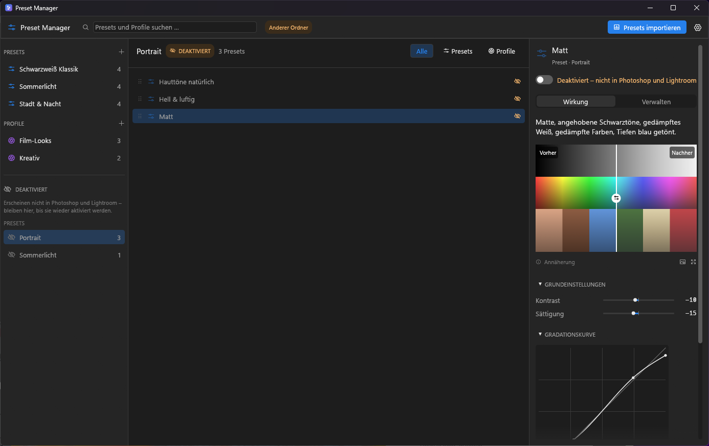

<div align="center">

<a href="README.md"></a>
&nbsp;
<a href="README.de.md"></a>

<br><br>


# Preset Manager

**Die Presets und Profile von Photoshop und Lightroom Classic ordnen, verstehen und an- oder abschalten.**

Kostenlos und quelloffen, für Windows 10 und 11

[](https://github.com/suebi76/preset-manager/releases/latest)
[](https://github.com/suebi76/preset-manager/releases)
[](https://github.com/suebi76/preset-manager/actions/workflows/ci.yml)
[](LICENSE)


</div>

## Wozu?

Photoshop und Lightroom Classic können Presets selbst importieren. Wächst die
Sammlung aber auf ein paar hundert Presets und Profile aus vielen Paketen,
wird das Ordnen dort mühsam: Gruppen müssen umgebaut, Presets einzeln
verschoben werden, und am Namen allein sieht man selten, was ein Preset macht.

Preset Manager arbeitet direkt mit den Dateien, die Photoshop, Photoshop
(Beta) und Lightroom Classic lesen. Es gibt keine eigene Bibliothek, und
nichts wird kopiert. Was man im Preset Manager ändert, zeigen die
Adobe-Programme nach einem Neustart an.

- **Die ganze Sammlung sehen:** alle installierten Presets und Profile,
  getrennt wie in Camera Raw, mit Suche und Filter.
- **Ordnung halten:** umbenennen, in andere Gruppen verschieben, sortieren,
  Gruppen anlegen und zusammenführen. Das geht auch für viele Einträge auf
  einmal, per Ziehen und Ablegen, Rechtsklick oder Tastatur.
- **Presets an- und abschalten:** Deaktivierte Presets bleiben im Preset
  Manager, erscheinen aber nicht mehr in Photoshop und Lightroom. Wieder
  aktiviert, liegen sie genau dort, wo sie vorher waren.
- **Sehen, was ein Preset macht:** eine kurze Beschreibung in Worten (etwa
  „heller, matte Schwarztöne, wärmer, Filmkorn“), eine Vorher/Nachher-Vorschau
  auf einem eigenen Foto und alle geänderten Einstellungen, gezeichnet wie in
  Camera Raw.
- **Neue Pakete hinzufügen:** Ordner oder ZIP-Datei ins Fenster ziehen, auch
  ZIP-Dateien in ZIP-Dateien. Bereits installierte Presets werden erkannt.
- **Sichern und weitergeben:** eine Auswahl oder ganze Gruppen als ZIP-Datei
  speichern, die sich auf jedem Rechner wieder installieren lässt.
- **Nichts geht verloren:** Jede Aktion lässt sich rückgängig machen
  (Strg+Z), Gelöschtes kommt in den Papierkorb, und jede Datei wird
  gesichert, bevor sie geändert wird.

Die Oberfläche gibt es auf Deutsch und Englisch. Sie richtet sich nach der
Sprache von Windows und lässt sich in den Einstellungen umstellen.

## Herunterladen

1. **[PresetManager-Setup.exe](https://github.com/suebi76/preset-manager/releases/latest)**
   aus dem neuesten Release herunterladen und starten.
2. Administratorrechte sind nicht nötig. Preset Manager steht danach im
   Startmenü und auf dem Desktop und hält sich selbst aktuell: Er zeigt einen
   Hinweis, wenn es eine neue Version gibt, oder installiert sie selbst, wenn
   man das in den Einstellungen wählt.

Ohne Installation: `PresetManager-Portable.zip` aus demselben Release
entpacken und `PresetManager.exe` starten.

Das Installationsprogramm ist nicht signiert. Windows SmartScreen fragt
deshalb einmal nach („Weitere Informationen“, dann „Trotzdem ausführen“). Wer
kein heruntergeladenes Programm starten möchte, kann es selbst bauen, siehe
[Aus dem Quellcode](#aus-dem-quellcode).

## Funktionen

| | |
|---|---|
| **Hinzufügen** | Ordner und ZIP-Dateien per Ziehen und Ablegen oder Auswahldialog · Vorschau, bevor etwas kopiert wird · bereits installierte Presets werden erkannt (gleiche UUID) · wenn eine Datei schon da ist: überspringen, ersetzen (mit Sicherung) oder beide behalten · auf eine Gruppe gezogen, landet alles direkt darin |
| **Verstehen** | Kurze Beschreibung in Worten · Vorher/Nachher auf einem eigenen Foto oder einer Testtafel; die Farbtabellen der Profile werden genau angewendet, der Rest ist eine Annäherung · alle geänderten Einstellungen wie in Camera Raw: Regler, Gradationskurve, Color-Grading-Räder, Farbmischer, Effekte, Masken |
| **Überblick** | Presets und Profile getrennt · Suche (Strg+F) · Filter (Strg+1/2/3) · Gruppe, Herkunft, Datei und UUID jedes Eintrags |
| **Aktivieren und deaktivieren** | Einzeln, als Auswahl oder ganze Gruppen (Auge, Rechtsklick, Strg+D oder Ziehen auf eine Gruppe) · Deaktivierte stehen getrennt · Favoriten in Camera Raw bleiben erhalten |
| **Exportieren** | Auswahl oder Gruppe als ZIP speichern (Rechtsklick, Details oder Strg+E) · je Gruppe ein Ordner, die Dateien unverändert · installierbar mit Preset Manager oder dem Import von Photoshop und Lightroom Classic |
| **Verwalten** | Umbenennen (F2) · in den Papierkorb (Entf) · in eine andere Gruppe verschieben · Reihenfolge ändern (Alt+↑/↓) · neue Gruppe aus der Auswahl (Strg+G) · Gruppen zusammenführen, indem man eine auf die andere zieht · mehrere auswählen (Strg/Umschalt+Klick, Strg+A) |
| **Sicher** | Rückgängig und Wiederholen (Strg+Z, Strg+Y), bis zu 20 Schritte; nur Dateien, die seitdem niemand geändert hat · Sicherungen der letzten 20 Aktionen · Dateien werden ganz oder gar nicht geschrieben · ZIP-Dateien werden vor dem Entpacken geprüft · geändert wird nur in den Preset-Ordnern von Adobe |
| **Komfort** | Deutsch und Englisch · Hinweis, wenn Photoshop oder Lightroom läuft (sie zeigen Änderungen nach einem Neustart) · einstellbare Größe der Oberfläche · findet den Camera-Raw-Ordner selbst, auch die Ordner neben Lightroom-Katalogen · Logdatei für die Fehlersuche · automatische Updates |

<div align="center">



</div>

## So funktioniert es

Photoshop, Photoshop (Beta) und Lightroom Classic lesen Presets aus einem
gemeinsamen Ordner, `%APPDATA%\Adobe\CameraRaw\Settings`. Preset Manager
findet ihn selbst und legt jedes Paket in einen eigenen Unterordner. Ist in
Lightroom Classic eingestellt, dass Presets mit dem Katalog gespeichert
werden, zeigen die Einstellungen auch den Ordner neben dem Katalog; ein Klick
wechselt dorthin.

In den `.xmp`-Dateien ändert Preset Manager nur Name, Gruppe und Reihenfolge.
Alle anderen Einstellungen bleiben, wie sie sind. Beim Deaktivieren kommt eine
Datei in einen Ordner, den Adobe nicht liest, beim Aktivieren zurück. Danach
Photoshop bzw. Lightroom neu starten, damit die Änderungen erscheinen.

| Was | Wo |
|---|---|
| Presets und Profile | `%APPDATA%\Adobe\CameraRaw\Settings\<Paket>\` |
| Deaktivierte Presets | `%APPDATA%\Adobe\CameraRaw\Preset Manager (inactive)\` |
| Das Programm | `%LOCALAPPDATA%\PresetManagerApp\` |
| Einstellungen | `%APPDATA%\PresetManager\` |
| Sicherungen (letzte 20 Aktionen), Logdateien (7 Tage) | `%LOCALAPPDATA%\PresetManager\` |

Deinstallieren (Windows-Einstellungen, Apps) entfernt nur das Programm.
Presets, Einstellungen und Sicherungen bleiben erhalten.

## Aus dem Quellcode

Voraussetzung: [Rust](https://rustup.rs) (stable).

`Start.bat` im Projektordner:

- **Doppelklick:** öffnet das Fenster.
- **Ordner oder ZIP-Datei auf `Start.bat` ziehen:** öffnet gleich die
  Importvorschau.

Beim ersten Start wird das Programm übersetzt, das dauert einige Minuten.

### Ausprobieren ohne die eigenen Presets

`scripts/demo_bibliothek.py` legt einen Camera-Raw-Ordner mit ausgedachten
Demo-Presets an. Über die Umgebungsvariable `APM_CAMERA_RAW_DIR` arbeitet die
App dann nur dort; oben im Fenster steht „Anderer Ordner“. In der
Eingabeaufforderung (`cmd`) im Projektordner:

```bat
python scripts\demo_bibliothek.py C:\Temp\DemoCameraRaw
set APM_CAMERA_RAW_DIR=C:\Temp\DemoCameraRaw
Start.bat
```

### Aufbau

| Ordner | Inhalt |
|---|---|
| `crates/preset_core` | Die gesamte Logik als Bibliothek, ohne Oberfläche |
| `crates/preset_manager` | Das Fenster (`src/main.rs`, [egui](https://github.com/emilk/egui)) und das Konsolenwerkzeug `preset_cli` |
| `Planung` | Anforderungen, Architektur, Fehlerkonzept, Tests, Roadmap, Oberflächen-Entwurf |
| `scripts` | Demo-Bibliothek, Release-Skript, Vorschaubild für GitHub |

Einstieg in die Planung: [Planung/00-Uebersicht.md](Planung/00-Uebersicht.md)

### Entwickeln

```bash
cargo test --workspace
```

```bash
cargo clippy --workspace --all-targets -- -D warnings
```

Ein neues Release: Version in `Cargo.toml` erhöhen, Abschnitt in
`CHANGELOG.md` schreiben, committen und pushen, dann
`scripts/New-Release.ps1 -Publish`. Das setzt das Tag; GitHub baut
Installationsprogramm und Update-Pakete mit [Velopack](https://velopack.io)
und veröffentlicht sie (`.github/workflows/release.yml`). Versionen wie
`1.7.0-beta.1` werden Testversionen und dürfen auch von einem Testzweig
kommen. Ohne `-Publish` entsteht ein Probe-Build; mit `-Version 1.7.0-probe.1`
und der Umgebungsvariable `APM_UPDATE_DIR` lassen sich Installation und Update
lokal ausprobieren.

### Konsolenwerkzeug

`preset_cli` listet ohne Angaben die installierten Einträge auf.
`importieren` zeigt eine Vorschau; kopiert wird erst mit `--ausfuehren`:

```bash
cargo run -p preset_manager --bin preset_cli -- importieren "Downloads\Paket.zip"
```

`fundorte` listet alle Camera-Raw-Ordner, die auf dem Rechner gefunden werden.
`vorschau <Preset.xmp> <Ausgabe.png> [Foto]` speichert Vorher und Nachher
nebeneinander als Bild. `--hilfe` zeigt alle Angaben.

## Unterstützen

Wenn Preset Manager dir nützt, hilft ein ⭐ auf GitHub anderen Fotografinnen
und Fotografen, ihn zu finden. Fehler und Ideen gern als
[Issue](https://github.com/suebi76/preset-manager/issues).

## Lizenz und Marken

MIT-Lizenz, siehe [LICENSE](LICENSE).

Adobe, Photoshop, Lightroom und Camera Raw sind Marken der Adobe Inc. Dieses
Projekt steht in keiner Verbindung zu Adobe und wird von Adobe weder
unterstützt noch geprüft.
