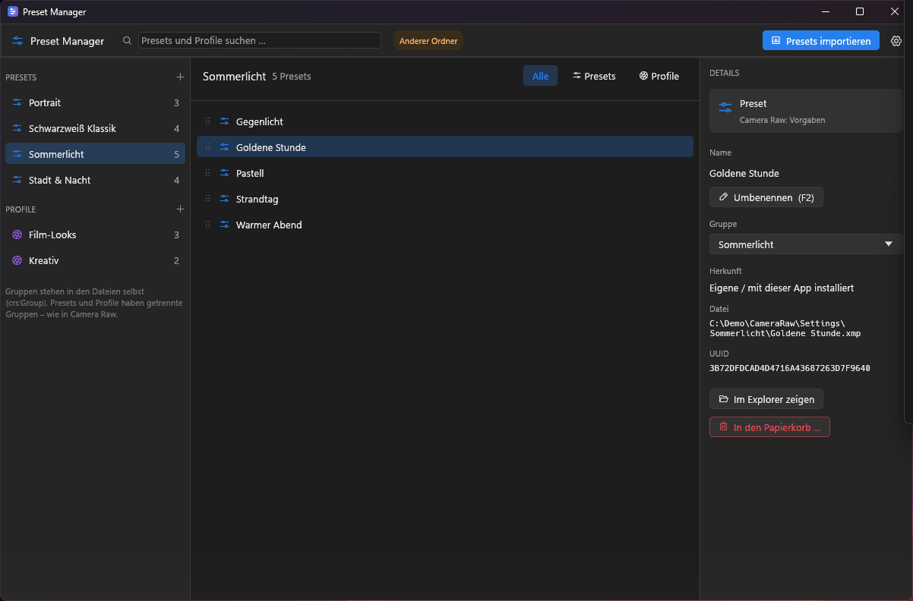

<div align="center">

<a href="README.md"></a>
&nbsp;
<a href="README.de.md"></a>

<br><br>


# Preset Manager

**Die Presets und Profile von Photoshop und Lightroom Classic an einem Ort verwalten – ordnen, verstehen, sicher ändern.**

Kostenlos und quelloffen · für Windows 10 und 11

[](https://github.com/suebi76/preset-manager/releases/latest)
[](https://github.com/suebi76/preset-manager/releases)
[](https://github.com/suebi76/preset-manager/actions/workflows/ci.yml)
[](LICENSE)




</div>

## Wozu?

Photoshop und Lightroom Classic können Presets selbst importieren. Wächst die
Sammlung aber auf ein paar hundert Presets und Profile aus vielen Paketen, wird
das Ordnen dort mühsam: Gruppen umbauen, viele Presets auf einmal verschieben,
Doppelte finden, verstehen, was ein Preset eigentlich macht.

**Preset Manager** arbeitet direkt mit den Presets und Profilen, die Photoshop,
Photoshop (Beta) und Lightroom Classic verwenden – keine eigene Bibliothek,
keine Kopien nebenher. Was man im Preset Manager ändert, zeigt Adobe nach
einem Neustart genau so an.

- **Alles auf einen Blick** – alle installierten Presets und Profile,
  getrennt wie in Camera Raw, mit Suche und Filter.
- **Ordnung halten** – umbenennen, in Gruppen verschieben, sortieren, Gruppen
  anlegen und zusammenführen, auch für viele Einträge auf einmal: per Ziehen
  & Ablegen, Rechtsklick oder Tastatur.
- **Aktivieren und deaktivieren** – die ganze Sammlung behalten, aber
  selbst bestimmen, was Photoshop und Lightroom zeigen. Deaktivierte stehen
  getrennt und kommen an genau dieselbe Stelle zurück.
- **Jedes Preset verstehen** – ein Satz in Klartext („heller, matte
  Schwarztöne, wärmer, Filmkorn“) und dazu Regler, Gradationskurve und
  Color Grading, gezeichnet wie in Camera Raw.
- **Neue Pakete hinzufügen** – Ordner oder ZIP ins Fenster ziehen, auch
  verschachtelte ZIPs. Bereits installierte Presets werden erkannt, Photoshop
  und Lightroom Classic bekommen alles zugleich.
- **Nie ein Preset verlieren** – Gelöschtes kommt in den Papierkorb, vor
  jeder Änderung wird das Original gesichert, Dateien werden nie halb
  geschrieben.

## Herunterladen

1. **[PresetManager-Setup.exe](https://github.com/suebi76/preset-manager/releases/latest)**
   aus dem neuesten Release herunterladen und starten.
2. Fertig – ohne Administratorrechte. Preset Manager steht im Startmenü und
   auf dem Desktop und **aktualisiert sich selbst** (mit Hinweis oder auf
   Wunsch automatisch).

Ohne Installation: `PresetManager-Portable.zip` aus demselben Release
entpacken und `PresetManager.exe` starten.

Das Installationsprogramm ist nicht signiert; Windows SmartScreen fragt deshalb
einmal nach („Weitere Informationen → Trotzdem ausführen“). Wer keinem
fertigen Programm trauen will, baut es selbst aus dem Quellcode – siehe
[Aus dem Quellcode](#aus-dem-quellcode).

## Funktionen

| | |
|---|---|
| **Hinzufügen** | Ordner und ZIP-Dateien per Ziehen & Ablegen oder Auswahldialog · Vorschau, bevor etwas kopiert wird · bereits installierte Presets werden erkannt (gleiche UUID) · bei vorhandenen Dateien: überspringen, ersetzen (mit Sicherung) oder beide behalten · auf eine Gruppe gezogen, landet alles direkt darin |
| **Verstehen** | Sehen, was ein Preset macht, bevor man es benutzt: ein Satz in Klartext und alle geänderten Einstellungen wie in Camera Raw – Regler, Gradationskurve als Zeichnung, Color-Grading-Räder, Farbmischer, Effekte, Masken |
| **Überblick** | Presets und Profile getrennt, mit Typ-Symbolen · Suche (Strg+F) · Filter (Strg+1/2/3) · Details: Name, Gruppe, Herkunft, Datei, UUID |
| **Aktivieren & deaktivieren** | Presets und Profile vor Photoshop und Lightroom verbergen, ohne sie zu löschen – einzeln, als Auswahl oder ganze Gruppen (Auge, Rechtsklick, Strg+D, Ziehen & Ablegen); Deaktivierte stehen getrennt und kommen an genau dieselbe Stelle zurück, Favoriten inklusive |
| **Verwalten** | Umbenennen (F2) · Löschen in den Papierkorb (Entf) · in andere Gruppe verschieben · Reihenfolge (Alt+↑/↓) · neue Gruppe aus Auswahl (Strg+G) · Gruppen zusammenführen · Mehrfachauswahl (Strg/Umschalt+Klick, Strg+A) |
| **Sicher** | Sicherungen der letzten 20 Aktionen · atomares Schreiben · ZIP-Prüfung gegen Pfadtricks, ZIP-Bomben und Riesendateien · arbeitet nur innerhalb der Adobe-Ordner |
| **Komfort** | Oberfläche auf Deutsch und Englisch (folgt Windows, in den Einstellungen umstellbar) · Hinweis, wenn Photoshop oder Lightroom läuft (sie zeigen Änderungen nach einem Neustart) · einstellbare Größe der Oberfläche · Logdatei für die Fehlersuche · Selbst-Update |

## So funktioniert es

Photoshop, Photoshop (Beta) und Lightroom Classic lesen Presets aus einem
gemeinsamen Ordner, `%APPDATA%\Adobe\CameraRaw\Settings`. Preset Manager
findet ihn selbst und legt jedes Paket in einen eigenen Unterordner. Speichert
Lightroom Classic Presets mit dem Katalog, zeigen die Einstellungen auch diesen
Ordner; ein Klick wechselt. In den `.xmp`-Dateien
ändert die App nur Name, Gruppe und Sortierung; alle anderen Einstellungen
bleiben unberührt. Danach Photoshop bzw. Lightroom neu starten.

| Was | Wo |
|---|---|
| Presets und Profile | `%APPDATA%\Adobe\CameraRaw\Settings\<Paket>\` |
| Das Programm | `%LOCALAPPDATA%\PresetManagerApp\` |
| Einstellungen | `%APPDATA%\PresetManager\` |
| Sicherungen (letzte 20 Aktionen), Logdateien (7 Tage) | `%LOCALAPPDATA%\PresetManager\` |

Deinstallieren (Windows-Einstellungen → Apps) entfernt nur das Programm;
Presets, Einstellungen und Sicherungen bleiben.

## Aus dem Quellcode

Voraussetzung: [Rust](https://rustup.rs) (stable).

`Start.bat` im Projektordner:

- **Doppelklick:** öffnet das Fenster.
- **Ordner oder ZIP auf `Start.bat` ziehen:** öffnet gleich die Importvorschau.

Beim ersten Start wird das Programm übersetzt, das dauert einige Minuten.

### Ausprobieren ohne die eigenen Presets

`scripts/demo_bibliothek.py` legt einen Camera-Raw-Ordner mit ausgedachten
Demo-Presets an. Über die Umgebungsvariable `APM_CAMERA_RAW_DIR` arbeitet die
App dann nur dort; oben im Fenster steht „Anderer Ordner“. In der
Eingabeaufforderung (`cmd`) im Projektordner:

```bat
python scripts\demo_bibliothek.py C:\Temp\DemoCameraRaw
set APM_CAMERA_RAW_DIR=C:\Temp\DemoCameraRaw
Start.bat
```

### Aufbau

| Ordner | Inhalt |
|---|---|
| `crates/preset_core` | Bibliothek mit der gesamten Logik, ohne Oberfläche |
| `crates/preset_manager` | Das Fenster (`src/main.rs`, [egui](https://github.com/emilk/egui)) und das Konsolenwerkzeug `preset_cli` |
| `Planung` | Anforderungen, Architektur, Fehlerkonzept, Tests, Roadmap, Oberflächen-Entwurf |
| `scripts` | Demo-Bibliothek, Release-Skript |

Einstieg in die Planung: [Planung/00-Uebersicht.md](Planung/00-Uebersicht.md)

### Entwickeln

```bash
cargo test --workspace
```

```bash
cargo clippy --workspace --all-targets -- -D warnings
```

Ein neues Release: Version in `Cargo.toml` erhöhen, Abschnitt in
`CHANGELOG.md` schreiben, committen und pushen, dann
`scripts/New-Release.ps1 -Publish`. Das setzt das Tag; GitHub baut
Installationsprogramm und Update-Pakete mit [Velopack](https://velopack.io)
und veröffentlicht sie (`.github/workflows/release.yml`). Versionen wie
`1.2.0-beta.1` werden Testversionen. Ohne `-Publish` entsteht ein Probe-Build;
mit `-Version 1.2.0-probe.1` und der Umgebungsvariable `APM_UPDATE_DIR` lassen
sich Installation und Update lokal ausprobieren.

### Konsolenwerkzeug

`preset_cli` listet ohne Angaben die installierten Einträge auf;
`importieren` zeigt eine Vorschau, kopiert wird erst mit `--ausfuehren`:

```bash
cargo run -p preset_manager --bin preset_cli -- importieren "Downloads\Paket.zip"
```

`fundorte` listet alle Camera-Raw-Ordner, die auf dem Rechner gefunden werden.
`cargo run -p preset_manager --bin preset_cli -- --hilfe` zeigt alle Angaben.

## Unterstützen

Wenn Preset Manager dir Zeit spart, **gib ihm einen ⭐ auf GitHub** – so finden
ihn auch andere Fotografinnen und Fotografen. Fehler und Ideen gern als
[Issue](https://github.com/suebi76/preset-manager/issues).

## Lizenz und Marken

MIT-Lizenz, siehe [LICENSE](LICENSE).

Adobe, Photoshop, Lightroom und Camera Raw sind Marken der Adobe Inc. Dieses
Projekt steht in keiner Verbindung zu Adobe und wird von Adobe weder
unterstützt noch geprüft.
