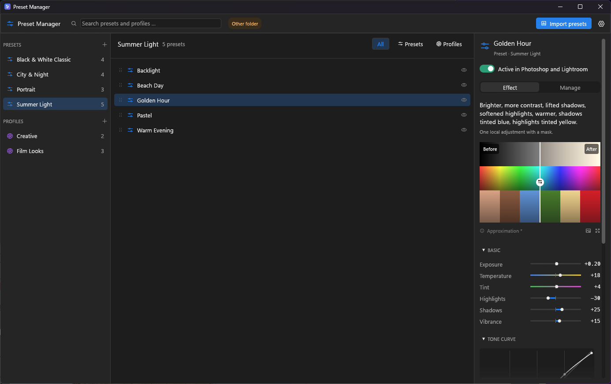
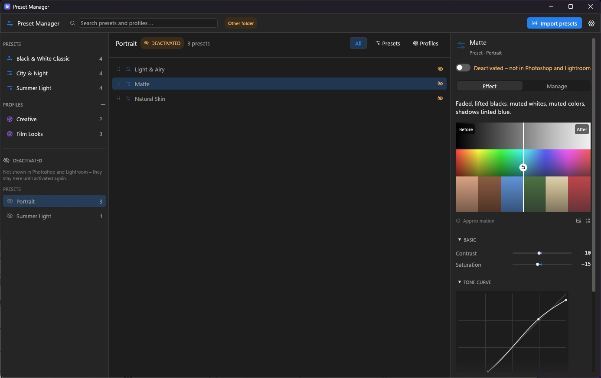

<div align="center">

<a href="README.md"></a>
&nbsp;
<a href="README.de.md"></a>

<br><br>


# Preset Manager

**Organize, understand and switch on or off the presets and profiles of Photoshop and Lightroom Classic.**

Free and open source, for Windows 10 and 11

[](https://github.com/suebi76/preset-manager/releases/latest)
[](https://github.com/suebi76/preset-manager/releases)
[](https://github.com/suebi76/preset-manager/actions/workflows/ci.yml)
[](LICENSE)




</div>

## Why?

Photoshop and Lightroom Classic can import presets themselves. Once a
collection grows to a few hundred presets and profiles from many packs,
keeping it in order there becomes tedious: groups have to be rebuilt, presets
moved one by one, and the name alone rarely tells you what a preset does.

Preset Manager works directly on the files that Photoshop, Photoshop (Beta)
and Lightroom Classic read. There is no separate library and nothing is
copied. What you change in Preset Manager appears in Adobe's programs after a
restart.

- **See your whole collection:** all installed presets and profiles, separated
  as in Camera Raw, with search and filters.
- **Keep it in order:** rename, move to other groups, sort, create and merge
  groups. Works for many items at once, by drag and drop, right-click or
  keyboard.
- **Switch presets on and off:** deactivated presets stay in Preset Manager
  but no longer appear in Photoshop and Lightroom. Activated again, they
  return to exactly the same place.
- **See what a preset does:** a short description in plain words (for
  example "brighter, faded blacks, warmer, film grain"), a before/after
  preview on your own photo, and every changed setting drawn as in Camera
  Raw.
- **Add new packs:** drop a folder or ZIP file into the window, nested ZIP
  files included. Presets that are already installed are recognized.
- **Back up and share:** save a selection or whole groups as a ZIP file that
  can be installed again on any computer.
- **Nothing gets lost:** every action can be undone (Ctrl+Z), deleted items
  go to the Recycle Bin, and every file is backed up before it is changed.

The interface is available in English and German. It follows the Windows
language and can be switched in the settings.

## Download

1. Download **[PresetManager-Setup.exe](https://github.com/suebi76/preset-manager/releases/latest)**
   from the latest release and run it.
2. No administrator rights are needed. Preset Manager appears in the Start
   menu and on the desktop and keeps itself up to date: it shows a notice
   when a new version is out, or installs it on its own if you choose that
   in the settings.

Without installing: take `PresetManager-Portable.zip` from the same release,
unzip it and start `PresetManager.exe`.

The installer is not code-signed, so Windows SmartScreen asks once
("More info", then "Run anyway"). If you would rather not run a downloaded
program, you can build it yourself, see [Build from source](#build-from-source).

## Features

| | |
|---|---|
| **Add** | Folders and ZIP files by drag and drop or file dialog · preview before anything is copied · already installed presets are recognized (same UUID) · if a file already exists: skip, replace (with backup) or keep both · drop onto a group to install straight into it |
| **Understand** | Short description in plain words · before/after preview on your own photo or a test chart; profile color tables are applied exactly, the rest is an approximation · every changed setting as in Camera Raw: sliders, tone curve, color grading wheels, color mixer, effects, masks |
| **Browse** | Presets and profiles in separate sections · search (Ctrl+F) · filters (Ctrl+1/2/3) · group, origin, file and UUID of each item |
| **Activate and deactivate** | Single items, a selection or whole groups (eye icon, right-click, Ctrl+D, or drag onto a group) · deactivated items are listed separately · favorites in Camera Raw are kept |
| **Export** | Save a selection or a group as a ZIP file (right-click, details or Ctrl+E) · one folder per group, files unchanged · installs with Preset Manager or with the import in Photoshop and Lightroom Classic |
| **Organize** | Rename (F2) · move to the Recycle Bin (Del) · move to another group · change the order (Alt+↑/↓) · new group from the selection (Ctrl+G) · merge groups by dragging one onto another · select several (Ctrl/Shift+click, Ctrl+A) |
| **Safe** | Undo and redo (Ctrl+Z, Ctrl+Y), up to 20 steps; only files nobody has changed since · backups of the last 20 actions · files are written completely or not at all · ZIP files are checked before unpacking · changes happen only inside the Adobe preset folders |
| **Convenient** | English and German · notice when Photoshop or Lightroom is running (they show changes after a restart) · adjustable interface size · finds the Camera Raw folder on its own, including folders next to Lightroom catalogs · log file for troubleshooting · automatic updates |

<div align="center">



</div>

## How it works

Photoshop, Photoshop (Beta) and Lightroom Classic read presets from one shared
folder, `%APPDATA%\Adobe\CameraRaw\Settings`. Preset Manager finds it on its
own and installs each pack into its own subfolder. If Lightroom Classic is set
to store presets with the catalog, the settings also list the folder next to
the catalog, and one click switches to it.

Inside the `.xmp` files Preset Manager changes only the name, the group and
the sort order. All other settings stay as they are. Deactivating moves a file
into a folder that Adobe does not read; activating moves it back. Afterwards,
restart Photoshop or Lightroom to see the changes.

| What | Where |
|---|---|
| Presets and profiles | `%APPDATA%\Adobe\CameraRaw\Settings\<pack>\` |
| Deactivated presets | `%APPDATA%\Adobe\CameraRaw\Preset Manager (inactive)\` |
| The program | `%LOCALAPPDATA%\PresetManagerApp\` |
| Settings | `%APPDATA%\PresetManager\` |
| Backups (last 20 actions), log files (7 days) | `%LOCALAPPDATA%\PresetManager\` |

Uninstalling (Windows Settings, Apps) removes only the program. Presets,
settings and backups stay where they are.

## Build from source

Needs [Rust](https://rustup.rs) (stable).

```bash
cargo run --release -p preset_manager --bin preset_manager
```

Or double-click `Start.bat`. Dropping a folder or ZIP file onto `Start.bat`
opens the import preview right away.

To try it without touching your own presets, `scripts/demo_bibliothek.py`
creates a demo library with made-up presets (`--english` for English names).
The environment variable `APM_CAMERA_RAW_DIR` points the app to it.

The project is planned and documented in German in [`Planung`](Planung/00-Uebersicht.md)
(requirements, architecture, error handling, tests, roadmap).
`crates/preset_core` contains all of the logic and is tested without a window;
`crates/preset_manager` is the [egui](https://github.com/emilk/egui) app and
the command-line tool `preset_cli`. Releases are built on GitHub with
[Velopack](https://velopack.io) (`scripts/New-Release.ps1`).

## Support the project

If Preset Manager is useful to you, a ⭐ on GitHub helps other photographers
find it. Bug reports and ideas are welcome as
[issues](https://github.com/suebi76/preset-manager/issues).

## License and trademarks

MIT License, see [LICENSE](LICENSE).

Adobe, Photoshop, Lightroom and Camera Raw are trademarks of Adobe Inc. This
project is not affiliated with Adobe and is neither endorsed nor reviewed by
Adobe.
